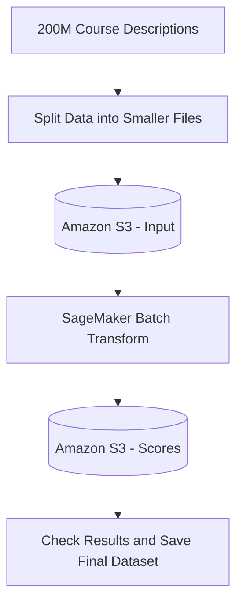

# Section 4 – Scalable ML Scoring Solution

## 1. Problem

We need to score approximately **200 million course descriptions** using a machine-learning model hosted on **Amazon SageMaker**. Processing descriptions one at a time is estimated to take **two months**.

The goal is to reduce processing time without losing records or producing duplicate results.

## 2. Proposed Solution

I recommend **SageMaker Batch Transform** because this is a large, offline scoring task. Instead of sending one request per description to a real-time endpoint, we can process input files in batches and use multiple inference instances.

### How it works

1. **Prepare data:** Give each description a unique `record_id` and split the dataset into smaller files.
2. **Store in S3:** Upload the files to Amazon S3.
3. **Run batch scoring:** Use SageMaker Batch Transform to process files across multiple instances. Choose the instance count and batch settings after testing.
4. **Save results:** Store predictions in S3 and keep each score linked to its `record_id`.
5. **Validate:** Check that every expected record has a valid score before publishing the final dataset.

*Assumption:* The existing model can be deployed with a Batch Transform-compatible inference container. This may require changes if it currently supports only real-time requests.

## 3. How This Improves Performance

| Current Approach | Proposed Approach |
|---|---|
| One description per request | Process descriptions in batches |
| Limited parallel processing | Use multiple inference instances |
| Estimated two months | Aim for a much shorter runtime, confirmed by testing |

The main improvement comes from **batching and parallel processing**. I would first test a smaller sample to measure records processed per second, then estimate the number of instances needed for the full dataset. The actual runtime depends on model speed, instance capacity, and cost limits.

## 4. Reliability and Cost

- **Avoid missing records:** Compare input record counts and IDs with output results.
- **Avoid duplicates:** Keep a unique `record_id` and do not publish duplicate scores for the same model version.
- **Handle failures:** Keep input files in S3 so failed files can be processed again.
- **Control cost:** Start with a small benchmark and select an appropriate instance type and count. Stop using compute after the batch job finishes.

## 5. Alternative

If the model cannot easily support Batch Transform, we can keep the existing SageMaker endpoint and send requests **concurrently in controlled batches**, with rate limits and retries. This may be easier to implement initially, but it requires more care to manage endpoint capacity and failed requests.

## 6. Conclusion

For 200 million descriptions, **SageMaker Batch Transform with S3** is a simple and scalable starting point. It replaces slow record-by-record requests with batch and parallel inference, while basic validation and retries help ensure complete results. A small performance test is needed before promising a specific completion time.
